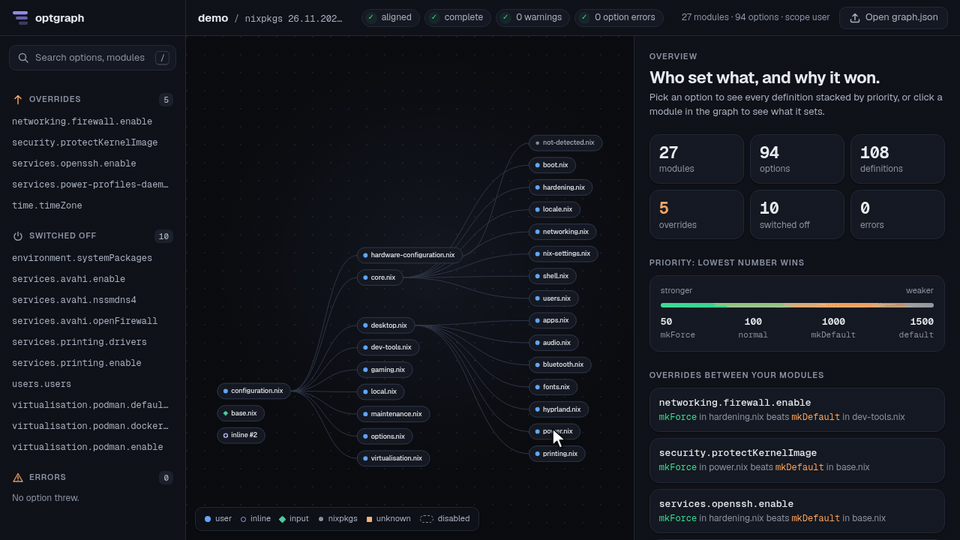
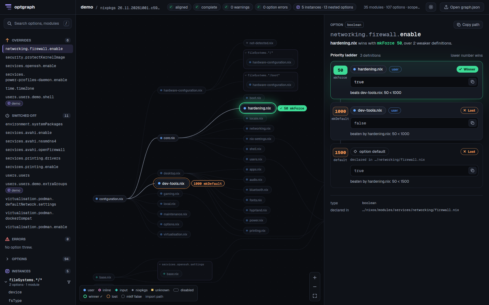
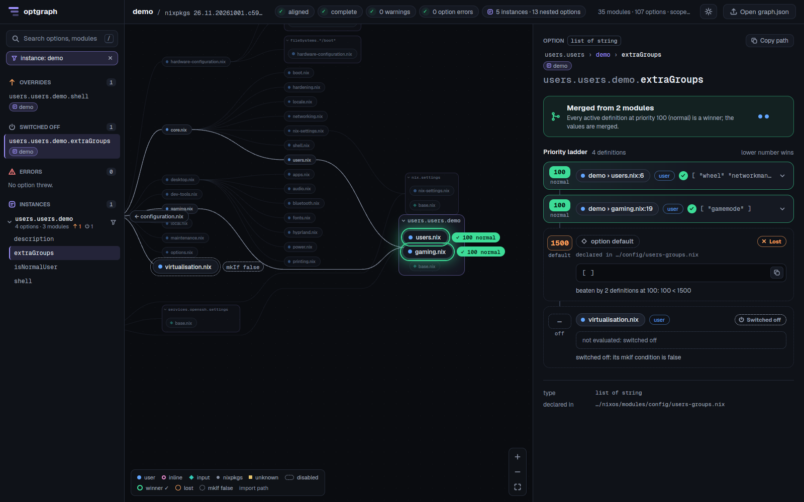
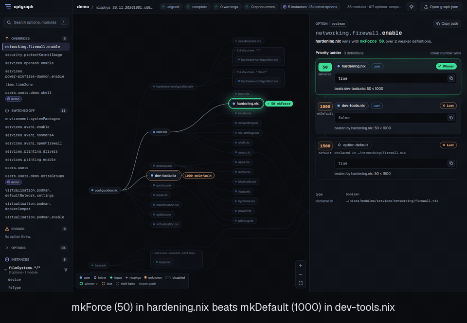

# optgraph

See how your NixOS flake is put together: which module set each option, at what priority, and why the other definitions lost.



## Quick start

You need Nix with flakes enabled. optgraph works on a `nixosConfigurations.<host>` of your flake; it evaluates purely and never writes your `flake.lock`.

**1. Try the live demo.** https://ilqqy.github.io/optgraph/ shows the graph of [`demo/`](demo/), a synthetic Hyprland desktop (no real machine). Good options to open: [`networking.firewall.enable`](https://ilqqy.github.io/optgraph/?opt=networking.firewall.enable) (`mkForce` beats `mkDefault`), [`services.printing.enable`](https://ilqqy.github.io/optgraph/?opt=services.printing.enable) (set under a false `mkIf`, so the default wins), [`environment.systemPackages`](https://ilqqy.github.io/optgraph/?opt=environment.systemPackages) (a list merged from six modules). [`?tour`](https://ilqqy.github.io/optgraph/?tour) plays the animation above.

**2. One HTML file for your own configuration.** From your flake's directory:

```sh
nix run github:ilqqy/optgraph -- .#nixosConfigurations.<host> --html graph.html
```

Open `graph.html` in any browser. It works offline and makes no network requests. Add `-o graph.json` to also get the raw data.

**3. The native app.** A desktop app (Rust, [GPUI](https://gpui.rs), Linux, tested on Wayland) that runs the extractor for you and shows its progress:

```sh
nix run github:ilqqy/optgraph#app -- .#nixosConfigurations.<host>
```

There is no binary cache yet, so the first run compiles GPUI and the app, which takes several minutes.

## What you see

- **The priority ladder.** Pick an option and every definition of it is listed as a card, strongest first: the module that wrote it, its priority (50 `mkForce`, 100 normal, 1000 `mkDefault`, 1500 option default; lower wins), its value preview and a one-line reason (`beats dev-tools.nix: 50 < 1000`, `switched off: its mkIf condition is false`). Lists and attribute sets that merge several winners show one compact row per module.
- **The import graph.** Your modules laid out left to right, from your `nixosSystem` modules to what they import, with origins marked: your files, inline modules, flake inputs, nixpkgs. A selected option rings its defining modules (green winner, amber lost, dashed when switched off) and keeps the import paths to them lit.
- **The command palette.** `/` or Ctrl+K: fuzzy search over options, modules and instances, grouped into overrides, switched-off definitions, errors, options and modules ([screenshot](docs/native-palette.png)).
- **Submodule instances.** Definitions inside `users.users.<name>`, `home-manager.users.<name>`, `fileSystems."/boot"` and the like get their own ladders, with a breadcrumb (`users.users › demo › extraGroups`). In the native app each instance is a group in the sidebar and a cluster in the graph, and the instance filter shows just one of them.
- **Start page lists.** *Overrides* (a definition lost to a stronger one), *Switched off* (under a false `mkIf`) and *Errors* (options that throw), so the interesting spots are one click away.





## Native app



```sh
nix run github:ilqqy/optgraph#app -- graph.json                                  # a graph.json made by optgraph
nix run github:ilqqy/optgraph#app -- graph.json --opt networking.firewall.enable # open an option (or --module <index>)
nix run github:ilqqy/optgraph#app -- graph.json --instance users.users.demo      # filter to one instance
```

It shows what the web viewer shows, plus instance groups and clusters. Keys: `/` or Ctrl+K search, arrows walk the lists, Enter opens, Esc clears, Ctrl+O opens another `graph.json` (or drop one on the window). The theme is dark unless the desktop portal says the system prefers light; `--light` and `--dark` pin it. The web viewer has deep links (`?opt=`, `?module=`), a mobile layout and the tour; the app has none of those.

## How it works

1. `optgraph` (Nix library + a thin CLI around `nix eval`) evaluates your configuration and reads nixpkgs' module graph (`.graph`) and each option's definitions.
2. It rebuilds every definition's priority and `mkIf` state, checks its winners against the module system's own answer, and previews values with a bounded printer (never the raw value).
3. Everything goes into one `graph.json`, described by [`schema/graph.schema.json`](schema/graph.schema.json) and [docs/schema.md](docs/schema.md).
4. Two viewers read that same file: the single-file web page (`--html`) and the native app.
5. Errors that `builtins.tryEval` cannot catch are recovered by re-running with the failing option or module left out, each recorded as a warning.

Flags, exit codes, the full viewer and app reference, crash handling and measurements: [docs/usage.md](docs/usage.md).

## Limitations

- **Plain `nixosSystem` only.** A configuration built some other way falls back to file-based attribution with an `alignment-failed` warning: origins come from file paths only, inline modules may be misattributed. Only `nixos/lib/eval-config.nix` called directly was tried; wrappers such as flake-parts or snowfall were not (one that calls `nixosSystem` unchanged should stay aligned).
- **NixOS only.** Standalone home-manager and nix-darwin configurations are not supported; home-manager as a NixOS module is.
- **nixpkgs 25.11 or newer.** It is the first release with the module graph optgraph reads; older ones are refused (`nixpkgs-unsupported`).
- **Submodule depth.** `submodule`/`submoduleWith` options, `attrsOf`/`lazyAttrsOf` of one and `nullOr` of one are attributed down to `--submodule-depth` instance levels (default 3; on nixpkgs 25.11 `nullOr` stays a leaf). `listOf` of a submodule, nested `attrsOf (attrsOf submodule)`, `either`/`oneOf`/`coercedTo` and similar wrappers, and freeform keys without a declared option (most of `services.*.settings`) stay leaves: one option with each module's whole definition, nothing inside attributed.
- **Ordering falls back.** `mkBefore`/`mkAfter`/`mkOrder` on an option's or an instance's definitions, a winning definition that is not a plain attribute set, or an instance that does not evaluate turn that option or instance back into a leaf with a `nested-degraded` warning instead of guessing.
- **Scope.** By default only options that one of your (non-nixpkgs) modules defines are shown, and nixpkgs' own definitions of them are counted rather than listed. `--all` and `--include-all-definitions` lift this, at a cost.
- **Cost.** A real desktop configuration takes about 20 s and 2 GB of RAM; each expanded home-manager user adds its own evaluation. Every uncatchable crash means a full re-run, so a configuration with a broken input can take twice as long. `--submodule-depth 0` skips instance expansion.

## Privacy

`graph.json` and the HTML page contain value previews of your options. They are bounded in size but not scrubbed: redaction is by option name only (paths containing `password`, `passwd`, `secret`, `token`, `private`, `credential` or `api_key`/`api-key`/`apikey`; numbers and booleans are still shown). A secret in, say, `environment.etc` or a service's `settings` will be visible. Look before you share either file.

## Development

```sh
nix develop                        # gh, jq, nixfmt, check-jsonschema, ffmpeg, python3
nix develop .#native               # Rust, GPUI's libraries, cage, grim, wtype, lavapipe
nix flake check -L                 # extractor checks on the fixture and the demo, schema validation, optgraph-core tests
nix fmt                            # nixfmt (RFC style)
nix develop -c tests/e2e.sh        # CLI end to end: crash recovery, bisection, budget, exit codes, --html
nix run . -- ./demo#nixosConfigurations.demo -o demo.json   # the live demo's graph
tools/render-native-tour.sh        # rebuilds docs/native-tour.gif from headless screenshots of the app
```

`tools/render-native-tour.sh` builds the app and the demo's graph, takes one software-rendered screenshot per scene with `tools/native-shot.sh` (cage on a headless output, no display needed), adds captions and crossfades with ffmpeg; two runs give byte-identical GIFs. The web tour (`docs/demo.gif`, `docs/demo.webm`) is rendered from the viewer itself by `tools/render-tour.sh`, which needs a system Chromium; see [docs/usage.md](docs/usage.md#regenerating-the-tours).

Layout: `nix/` the extraction library, `cli/` the `nix eval` wrapper, `viewer/` the web viewer, `app/` the native app (`optgraph-core` without GUI dependencies, `optgraph-app`), `schema/` the output schema, `tests/fixture/` a flake that breaks options on purpose, `demo/` the demo flake, `tools/` the tour renderers and screenshot tools, [docs/module-system-notes.md](docs/module-system-notes.md) verified findings about `lib/modules.nix`.

## License

MIT, see [LICENSE](LICENSE). The bundled Geist fonts are under the SIL Open Font License 1.1 (`viewer/vendor/fonts/OFL.txt`).
