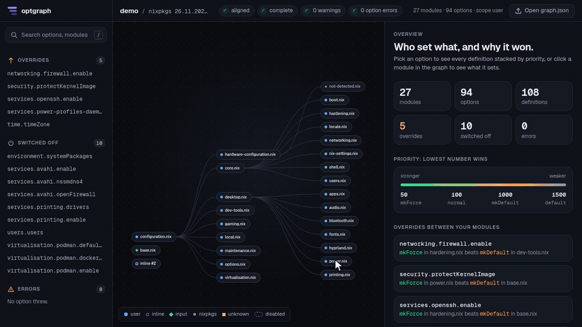
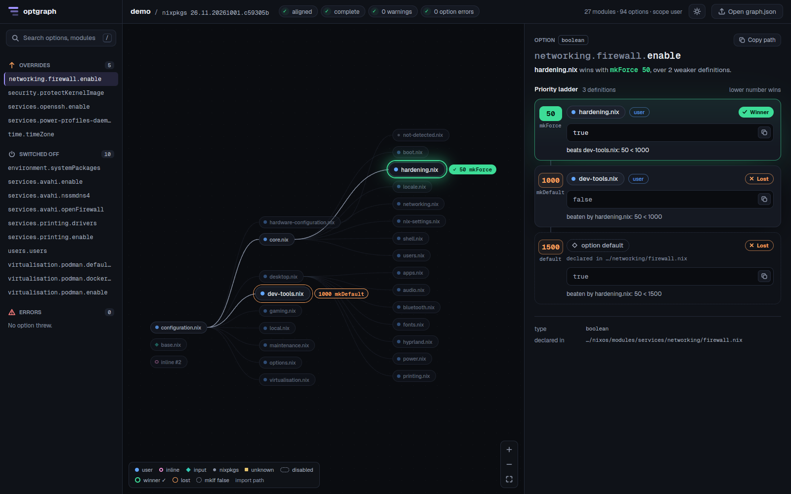
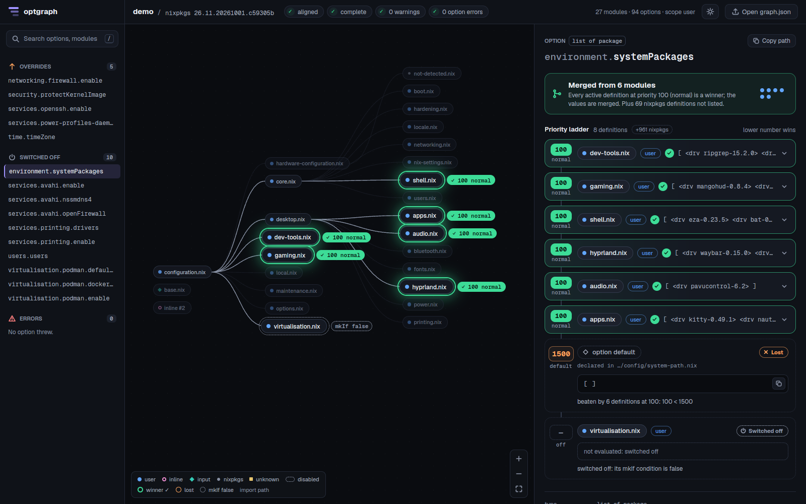
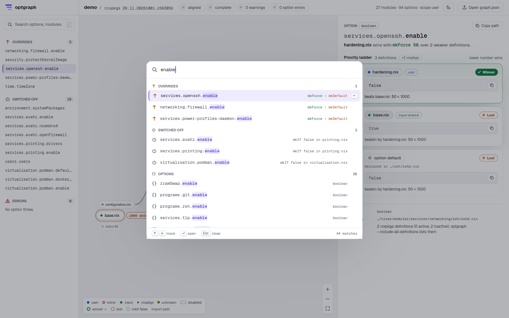

# optgraph

Shows how a NixOS flake configuration is put together: the module import graph, and for every option who sets it, at what priority, and why one definition won over the others.



`optgraph` evaluates a `nixosConfigurations.<host>` of your flake and writes `graph.json`: the modules and where they come from (your files, inline modules, flake inputs, nixpkgs), and all definitions of each option you touch, including the ones that lost and the ones switched off by `mkIf`. With `--html` it also writes a single-file interactive viewer of the same data.

Live demo: https://ilqqy.github.io/optgraph/ ([Watch the tour](https://ilqqy.github.io/optgraph/?tour): the animation above, played by the viewer itself)

It shows the graph of [`demo/`](demo/), a synthetic Hyprland desktop configuration (no real machine, the only user is `demo`). Options worth opening:

- `mkForce` beats `mkDefault`: [`networking.firewall.enable`](https://ilqqy.github.io/optgraph/?opt=networking.firewall.enable), turned off with `mkDefault` in `dev-tools.nix` and forced on in `core/hardening.nix`.
- `mkIf false`: [`services.printing.enable`](https://ilqqy.github.io/optgraph/?opt=services.printing.enable), set in `desktop/printing.nix` behind the `demo.features.printing` flag, which is off, so the option default wins.
- Several winners: [`environment.systemPackages`](https://ilqqy.github.io/optgraph/?opt=environment.systemPackages), a list set in six modules (plus one inactive definition), with the nixpkgs definitions counted as `+961 nixpkgs`.

Status: phase 2 of 4 (extractor and viewer). Diff and polish are not started.

## Install and run

Requires Nix with flakes enabled. Developed and tested with Nix 2.34.8 on x86_64-linux; the package is also exposed for aarch64-linux, which was not run.

From a checkout, on the demo configuration (first run downloads the demo's nixpkgs):

```sh
nix run . -- ./demo#nixosConfigurations.demo -o graph.json
```

From GitHub: <!-- unverified: the repository is not published yet -->

```sh
nix run github:ilqqy/optgraph -- <flakeref>#nixosConfigurations.<host> -o graph.json
```

Or build once and call the binary:

```sh
nix build . && ./result/bin/optgraph --help
```

The argument is `<flakeref>#nixosConfigurations.<host>`. The attribute must be a configuration (a `nixosSystem` result). The CLI never passes `--impure` and forces `--option pure-eval true`, so evaluation stays pure whatever your Nix config says. The target flake's `flake.lock` is never written (`--no-write-lock-file`).

Logs go to stderr. Without `-o` the JSON goes to stdout. With `-o` it is written to a temporary file next to the target and renamed, so a failed run leaves no partial file (except the deliberate partial document of exit code 3, below). A write error exits 2.

### Flags

| Flag | Meaning |
|---|---|
| `-o`, `--output FILE` | Write `graph.json` to `FILE`. Default: stdout (unless `--html` is given). |
| `--html FILE` | Write a self-contained viewer page with the graph embedded. Can be combined with `-o`. |
| `--all` | No scope filter: every declared option and every loaded module. Slow and big, see [Measured](#measured). |
| `--include-all-definitions` | List every definition. By default, nixpkgs definitions that neither win nor come from a non-nixpkgs module are only counted (`options[].omitted`); the option default is always listed. Independent of `--all`. |
| `--submodule-depth N` | Attribute definitions inside submodule instances (`users.users.<name>`, `home-manager.users.<name>`, ...) down to `N` instance levels. Default 3. `0`: submodule-typed options stay leaves and the output has no nested records. See [Limitations](#limitations). |
| `--max-retries N` | Number of uncatchable crashes to recover from by re-running. Default 10, with `--all` 100. The (N+1)th crash ends the run with partial output and exit 3. The fixture crashes 4 times on purpose (one of them in a submodule instance): `--max-retries 4` completes, `--max-retries 3` ends partial. |
| `--time-budget SECS` | Wall-clock budget for all evaluations. Default 600, with `--all` 1800. Each evaluation runs under `timeout` with what is left of the budget; an evaluation that is killed (status 124), or a budget that runs out between evaluations, ends the run as exhausted (exit 3). The partial-output evaluations that follow have their own limit of `max(120, SECS/4)` seconds each, so the total can exceed `SECS`. |
| `-h`, `--help` | Usage. |

### Exit codes

| Code | Meaning |
|---|---|
| 0 | Done. |
| 1 | Usage error. |
| 2 | Flake or evaluation error. No output is written. The flake or attribute cannot be resolved; the value is not a NixOS configuration (`not-a-configuration`); nixpkgs is older than 25.11 or has no `.graph` (`nixpkgs-unsupported`); the configuration does not evaluate (`config-broken`); a crash could not be localized; or the output cannot be written. Coded errors print as `optgraph: error: <code>: <message>`. |
| 3 | Crash recoveries or time budget exhausted. A partial document with `meta.complete = false` and a `budget-exhausted` warning is still written: up to two more evaluations, first with previews and the self-check off for all options, then with no options (modules only). |

## What you get

`graph.json` has three parts: `meta`, `modules`, `options`. The full field reference is in [docs/schema.md](docs/schema.md); the JSON Schema is `schema/graph.schema.json`.

- `modules`: every module in the scope with its imports and an origin: `user`, `user-inline` (an anonymous module whose code is yours; the ones that are entries of your `nixosSystem { modules = [ ... ]; }` list also get `modulesIndex`), `input:<name>`, `nixpkgs` or `unknown`. Anonymous modules are attributed by the file they live in, or, when their `_file` is only a fallback, by the position of their code. `position` is the `file:line` of a module's first attribute. Modules disabled through `disabledModules` are listed as disabled.
- `options`: for each option that one of your modules defines, every definition from every module: priority (1500 default, 1000 `mkDefault`, 100 plain, 50 `mkForce`, 10 `mkVMOverride`), whether it is active (`mkIf` conditions), a bounded value preview (never the raw value), which definitions won, and the resulting `highestPrio`. The option's own default is always listed as the last definition, also when it lost. When a value or condition throws, the winner is unknown: `highestPrio` is `null`, `winners` is empty and `error` says so.
- Inside submodule instances: definitions of options such as `users.users.alice.shell` or `home-manager.users.<name>.programs.git.enable` are options of their own, with the same priority ladder and the module that wrote each definition (`instance` and `parent` name the enclosing instance and the option that holds it). A definition that never reached an instance because the whole instance definition lost on priority (`users.users.dave = mkForce { ... }` elsewhere) is listed with `shadowedAt`. The submodule-typed option itself (`users.users`) is listed as before.
- `meta.warnings`: everything that went wrong or was degraded, with a machine-readable code.

On the demo (the commands were run on the output of the call above):

```sh
jq -r '.options[] | select(.path == "networking.firewall.enable") | .definitions[] | [.priority, (.module // "(option default)" | sub("^.*/demo/"; "")), .valuePreview] | @tsv' graph.json
```

```
1000	modules/dev-tools.nix	false
50	modules/core/hardening.nix	true
1500	(option default)	true
```

`mkForce` (50) wins over `mkDefault` (1000) and over the option default (1500). A definition under a false `mkIf` is listed with unknown priority, and here the option default wins:

```sh
jq -r '.options[] | select(.path == "services.printing.enable") | .definitions[] | [(.priority // "?"), .active, (.condition // "-"), (.valuePreview // "-")] | @tsv' graph.json
```

```
?	false	mkIf-false	-
1500	true	-	false
```

A list set in several modules has several winners; only the non-nixpkgs definitions are listed:

```sh
jq -c '.options[] | select(.path == "environment.systemPackages") | {listed: (.definitions | length), winners: (.winners | length), omitted}' graph.json
```

```
{"listed":8,"winners":6,"omitted":{"nixpkgsActive":69,"nixpkgsInactive":892,"nixpkgsWinners":69}}
```

`nixpkgsWinners` is how many of the omitted active definitions win (75 winners in all here). When none of your definitions wins, for example a list you set with `mkDefault` while nixpkgs sets it at normal priority, `winners` is empty and `nixpkgsWinners` says how many nixpkgs definitions win at `highestPrio`.

Six definitions win, the seventh is under a false `mkIf`, the eighth is the option default (`[ ]`), which lost.

Where the modules come from (`input:shared` is the demo's second local input, `user-inline` the module written inline in `demo/flake.nix`, `nixpkgs` the `not-detected.nix` profile that `hardware-configuration.nix` imports):

```sh
jq -r '.modules[].origin' graph.json | sort | uniq -c
```

```
      1 input:shared
      1 nixpkgs
     24 user
      1 user-inline
```

The demo has no warnings (`jq '.meta.warnings | length' graph.json` prints `0`). Crashes, throwing options and the warnings they cause are exercised by `tests/fixture`, which breaks options on purpose.

## Viewer

`optgraph … --html graph.html` writes one HTML file that opens offline in any browser. The same viewer without embedded data is `nix build .#viewer` (`result/index.html`); open a `graph.json` in it with *Open graph.json* or by dropping the file onto the page, or serve it next to a graph and open `index.html?src=graph.json`. Served over http(s) with no embedded data and no `?src=`, the page loads `./demo.json` if the site has one (that is how the live demo works); opened as a `file://` page it shows the drop zone.

Layout: a slim sidebar on the left (the search box and three lists with counts), the import graph in the middle, a wide inspector on the right, and a top bar with the host, the nixpkgs version and status chips (attribution, `complete`, warnings, option errors; the last two open their list).

- Start (nothing selected): the sidebar lists *Overrides* (options where a listed definition lost to a stronger one, conflicts between non-nixpkgs modules first; the option default losing does not count, a listed definition beaten only by omitted nixpkgs winners does (`normal in nixpkgs (39 not listed) beats mkDefault in lists.nix`), omitted nixpkgs definitions themselves never do), *Switched off* (definitions from non-nixpkgs modules under a false `mkIf`) and *Errors* (options whose `error` is set). The inspector shows the counts of modules, options, definitions, overrides, switched-off definitions and errors, the priority scale (50 mkForce, 100 normal, 1000 mkDefault, 1500 default; lower wins) and the first overrides, e.g. `mkForce` in hardening.nix beats `mkDefault` in dev-tools.nix.
- Option detail: the path, its type and a verdict ("hardening.nix wins with mkForce 50, over 2 weaker definitions"), then the priority ladder: one card per listed definition, sorted by priority (lowest first, unknown last) on a rail of priority badges with their names. Each card has the module (click it to open the module), its origin, a status (*Winner*, *Lost*, *Switched off*, *Unknown*: a mark, a word and a border style, never colour alone), the value preview with a copy button, and a one-line reason computed from the data: `beats dev-tools.nix: 50 < 1000`, `beaten by hardening.nix: 50 < 1000`, `switched off: its mkIf condition is false`, `merged with 5 others at priority 100`; omitted nixpkgs winners count as winners there (`merged with 74 others at priority 100 (69 nixpkgs, not listed)`, `beaten by 39 nixpkgs definitions at 100 (not listed): 100 < 1000`). When every winner is an omitted nixpkgs definition, the verdict says so: "39 nixpkgs definitions win at priority 100 (not listed), over 2 weaker definitions". Options with several winners (lists, attribute sets) get a *Merged from N modules* header (*and M nixpkgs definitions* when some are omitted) and one compact row per winner (priority, module, origin, the value preview on one line), which a click, Enter or Space expands to the full card; the option default is a dashed card. `+N nixpkgs` counts definitions that were omitted. *Copy link* copies a deep link to the option. Cards come in with a short staggered animation, none with `prefers-reduced-motion`.
- Module detail: its file, id, position and origin, how many options it sets, imports and importers, and the options it sets with its status and priority for each.
- Graph: a layered left-to-right layout of the import graph computed in the page (longest-path layers from the roots, dummy nodes for long edges, barycenter sweeps against crossings; `viewer/src/layout.js`). Modules are pills with a short label and an origin mark that differs in shape and colour (user disc, user-inline ring, `input:*` diamond, `unknown` square, nixpkgs small grey disc); edges are curves, disabled modules dashed. Selecting an option rings its defining modules (winner: solid green ring with a glow and a `✓ 50 mkForce` chip; lost: amber ring and chip; `mkIf` false: dashed ring and chip), dims the rest (their labels stay readable, at least 3:1 on the canvas), keeps the import paths to them lit and eases the camera to fit them and their importers back to the roots. The defining modules keep 12 px labels at any zoom: below 100 % they are drawn at full size over the receded graph, like pins on a map. When the paths back to the roots need a zoom below 20 %, or the pins would overlap there, the camera fits only the defining modules, and if those don't fit either, as many as fit, winners first (the ladder lists all of them). A selected module is pinned the same way. Hovering a module shows its full path, origin and how many options it sets; clicking it opens the module. Drag to pan; zoom with the wheel, a pinch or the buttons. Above 300 modules (`--all`) only the non-nixpkgs modules are drawn, with a banner.
- Command palette: `/` or Ctrl+K (⌘K) opens it, and so does the sidebar's search box. Fuzzy search over option paths and modules (short label or path), matched characters highlighted; if some path contains the query, only those are listed. Results come in groups: Overrides, Switched off, Errors, Options, Modules. Arrows move, Enter opens, Esc closes.
- Keys: `/` and Ctrl+K the palette; `Esc` closes the palette or the warnings panel, else clears the selection (back to the start summary).
- Themes: light and dark follow the system setting. Text keeps at least 4.5:1 contrast on its background in both.
- Mobile (up to 760 px wide): the graph fills the screen and a bottom tab bar replaces the sidebar (Graph, Search, Overrides, Off, Errors; the lists open as a bottom sheet). The inspector is a bottom sheet: it peeks with its title, opens to 60 % when you pick an option or module, and its handle toggles or drags it to full height.
- Deep links, for embedded data and `?src=` alike: `?opt=<option path>` opens that option's ladder and highlights its modules, `?module=<index or id>` opens a module (index into `modules`, or its `id`), `?warnings` opens the warnings panel. The address bar follows the selection (`history.replaceState`), so it is always a link to what you see. Example: `graph.html?opt=networking.hostName`, `https://ilqqy.github.io/optgraph/?module=0`.
- Tour: `?tour` plays a 19-second scripted walk through the viewer (the GIF at the top), driving the real palette, lists, ladder and graph with a drawn cursor, key caps and captions; Pause/Play/Restart and *Exit tour* sit at the bottom right of the graph, and any real click or key hands the page back. With `prefers-reduced-motion` it waits for *Play* and jumps instead of moving. It shows the demo's `networking.firewall.enable`, `services.printing.enable`, `i18n.defaultLocale` and `environment.systemPackages`; on another graph it takes the first options that fit each scene, and does not start if one is missing. Captions take module names and priorities from the graph. `?tour&t=<ms>` renders the single frame at that time, which is how the GIF is made.
- Local only: no analytics and no external requests. The page's Content-Security-Policy allows inline code only and limits `fetch` (`?src=`) to the page's own origin. The fonts are Geist and Geist Mono (SIL Open Font License 1.1, licence in `viewer/vendor/fonts/OFL.txt`), Latin subsets made by `tools/subset-fonts.sh` from nixpkgs' `geist-font` 1.7.0, pinned by `viewer/vendor/fonts/SHA256SUMS` (checked by `viewer/build.sh`) and inlined as base64. The page builds them with the `FontFace` API from those bytes, so nothing is fetched and the CSP needs no `font-src`. The whole page is about 200 KB; the viewer check keeps it under 250 KB.

## Native app

A desktop app with the viewer's function: who set an option, at what priority, and why the others lost. It is written in Rust with [GPUI](https://gpui.rs) (Zed's UI framework, the `gpui-pre` 0.3.10 snapshot from crates.io), Linux first: tested on Wayland; GPUI's X11 backend is built in but was not tried. The web viewer stays the zero-install way to look at a graph; the app is for working with your own configuration at your desk.



```sh
nix run .#app -- graph.json                                   # a graph.json made by optgraph
nix run .#app -- /etc/nixos#nixosConfigurations.myhost        # runs optgraph first, shows its progress
nix run .#app -- graph.json --opt networking.firewall.enable  # open an option (or --module <index>)
```

With a flake reference the app runs the optgraph CLI on a background thread (the package sets `OPTGRAPH_CLI`; outside the package it uses `optgraph` on `PATH`), shows the CLI's progress lines while it evaluates, then the graph; if the evaluation fails, the CLI's error. A partial graph (exit 3) loads with its warnings. `-` reads `graph.json` from stdin. Ctrl+O, the top bar's *Open graph.json* or dropping a file on the window opens another graph (the file dialog is xdg-desktop-portal's; without a portal the app says so).

What it shows is the web viewer's: the sidebar lists (*Overrides*, *Switched off*, *Errors*), the top bar's status chips and warnings panel, the priority ladder with its statuses and reasons (merged options as compact rows that open on click, Enter or Space), the module detail, the graph with rings, priority chips, dimming and the camera that keeps defining modules at 12 px labels, and the command palette (`/` or Ctrl+K). The derived data comes from `app/crates/optgraph-core`, a library without GUI dependencies whose tests compare its results with the web viewer's own code on the demo's graph (`viewer/src/data.js`, `search.js` and `layout.js` run under node by `app/scripts/`). Keys: `/` and Ctrl+K search, arrows walk the sidebar lists, Enter opens, Tab moves between compact rows, Esc clears; Ctrl+O opens a file. The colour scheme is dark unless the system explicitly prefers light (the desktop portal's `color-scheme` setting, read with `busctl` or `gdbus`; no portal or no preference: dark), and it follows changes; the top bar's toggle or `--dark`/`--light` pin it. The web viewer follows `prefers-color-scheme`.



Differences from the web viewer:

- When the path from a defining module back to the roots doesn't fit, the modules of that path that end up out of view get chips at the edge of the graph (an arrow and the module's name; a defining module's chip in its status colour); a click brings the module into view. The web viewer only fits what it can.
- The colour scheme: dark by default (see above); the web viewer is light when the browser reports no preference.
- No deep links (`?opt=` is `--opt`), no *Copy link* (the app copies the option path), no tour, no mobile layout, no touch gestures (pinch), and no animation of the ladder's cards.
- The fonts are the viewer's Geist and Geist Mono (`viewer/vendor/fonts`); `build.rs` decodes the WOFF2 files and cuts static 400 to 700 weights from the variable fonts, because GPUI picks faces by weight.



Measured (2026-10-26, Ryzen 5 5600, software rendering: cage's headless output with pixman and Mesa's lavapipe for Vulkan, 1600x1000): panning a synthetic 255-module graph takes 2.8 ms of the app's CPU time per frame (render and paint; 3.6 ms with an option selected), and frames arrive every 37 to 43 ms, the same as on the 27-module demo, so the software rasteriser sets that pace, not the graph. `OPTGRAPH_BENCH_PAN=<frames>` repeats the measurement. The first build of the package takes about 4 minutes.

### Developing the app

```sh
nix develop .#native                        # Rust, GPUI's libraries, cage, grim, wtype, lavapipe
cd app && cargo run -p optgraph-app -- crates/optgraph-core/tests/data/demo.json
cargo test -p optgraph-core                 # also checks.optgraph-core in nix flake check
tools/native-shot.sh -o /tmp/optgraph-native/shot.png -- app/target/debug/optgraph-app graph.json --dark
```

`tools/native-shot.sh` takes screenshots without a display: it runs the app in cage on a headless output (pixman), with lavapipe for Vulkan, a private runtime directory and no session D-Bus, and captures the output with grim. `-k` types keys first (wtype, e.g. `-k "-k slash -s 300 fire"`), `-x` runs a command in the session, e.g. `tools/native-pointer.py`, which drives a virtual pointer (moves, clicks, drags, the wheel) and keeps it there while the screenshot is taken. `nix build .#optgraph-app` builds the package; `.github/workflows/native.yml` builds it when `app/`, `flake.*` or the fonts change. `nix flake check` runs only optgraph-core's tests, with that crate's own `Cargo.lock`, so it doesn't build GPUI.

## Scope and support

- Default scope: options with at least one definition from a module that is not nixpkgs, plus the non-nixpkgs modules, their ancestors and their direct imports. `--all` lifts the filter. Inside submodule instances the same idea applies to "user-side" modules, and `--all` does not expand more instances ([docs/schema.md](docs/schema.md#submodule-instances)).
- nixpkgs 25.11 to 26.11 is supported. The fixture check passes with nixpkgs `c59305b` (26.11) and with nixos-25.11 (`b6018f87da91d19d0ab4cf979885689b469cdd41`), nested fixture cases included (re-run 2026-10-27). Older releases are refused (exit 2, `nixpkgs-unsupported`; run with nixos-25.05). A newer release works with a `nixpkgs-untested` warning.
- Configurations built with `nixpkgs.lib.nixosSystem` are supported. When a configuration is not built that way (tested: `nixos/lib/eval-config.nix` called directly) optgraph falls back to file-based attribution and adds an `alignment-failed` warning; `modulesIndex` is always `null`, and the wrapper nodes around inline modules show up as modules of their own. Other builders were not tried.
- Flake inputs are resolved with `nix flake archive --dry-run` and `nix flake metadata`, so evaluating a flake needs its inputs to be fetchable. Nested inputs are named `parent/child`. A relative `path:` input of the root flake is resolved as `<source root>/<dir>/<path>`.

## How crashes are handled

`builtins.tryEval` catches only `throw` and failed `assert`. Other errors (`abort`, missing attributes, ...) kill the whole `nix eval`, and nixpkgs has options that do this. optgraph handles them at the process level:

- Each unit of work (loading a module, walking its `config`, reconstructing an option, the self-check, the preview) runs inside an error-context marker. After a crash the CLI reads the innermost marker (the last one in the `--show-trace` output) and re-runs with that unit degraded: previews or self-check switched off for the option, or the option or module excluded. A crash while loading a module or while walking its `config` excludes the module. Each recovery shows up as a warning (`preview-crash`, `selfcheck-crash`, `eval-crash`) that carries the Nix error text.
- Without a marker the CLI bisects the in-scope options. `OPTGRAPH_LOCALIZE=bisect` forces this, for testing. It is coarser: the culprit option is excluded entirely. The fallback bisects top-level options only, so a crash inside an instance without a marker can exclude a whole top-level option such as `users.users`.
- Instances have their own recovery. An uncatchable crash while expanding one submodule instance excludes just that instance: it stays part of its option, its siblings are still expanded, and a `nested-crash` warning with the Nix error names it. A crash while listing an option's instances excludes that option's nesting (`nested-crash`, subject: the option). Nested options use the same preview and self-check recovery as top-level ones. Errors that `tryEval` can catch (an instance that does not evaluate, definitions that cannot be matched to their modules) degrade that option or instance to a leaf with a `nested-degraded` warning that names the reason.
- When the recovery limit or the time budget runs out, the CLI writes partial output (exit 3, see above).
- A built-in self-check compares the reconstructed winners (`highestPrio`, files) with what the module system reports. A difference becomes a `reconstruction-mismatch` warning; where the module system's own accessors throw or the winner is unknown, the check is skipped with a `selfcheck-skipped` warning. There were no mismatches on the fixture, with or without `--all`.

## Measured

Nix 2.34.8, nixpkgs `c59305b`, x86_64-linux, `/usr/bin/env time -v`; fixture `./tests/fixture#nixosConfigurations.test`, demo `./demo#nixosConfigurations.demo`:

| Run | Wall | Max RSS | JSON | Modules | Options | Evaluations / crash recoveries | Mismatches |
|---|---|---|---|---|---|---|---|
| fixture, default (2026-10-09) | 4.84 s | 302 MB | 41 KB | 24 | 31 | 4 / 3 (all deliberate) | 0 |
| fixture, `--all` (2026-10-03, before definitions were omitted by default) | 84 s | 1.43 GB | 20 MB | 3993 | 16812 | 14 / 13 (3 deliberate, 10 in stock nixpkgs options; by stage: 9 self-check, 3 preview, 1 reconstruct) | 0 |
| demo, default (2026-10-09) | 1.41 s | 305 MB | 119 KB | 27 | 94 | 1 / 0 | 0 |

With `OPTGRAPH_LOCALIZE=bisect` the default run takes 26 evaluations and 3 crash recoveries (2026-10-27). Timings vary by about a second between runs.

## Limitations

- Submodule instances are attributed down to `--submodule-depth` levels (default 3). Supported: `submodule`/`submoduleWith`, `attrsOf`/`lazyAttrsOf` of one, `nullOr` of one (on nixpkgs 25.11 `nullOr` does not expose the instance, so it stays a leaf there; on unstable it is expanded). The following stay leaves, shown as one option with its definitions per module and nothing inside attributed: `listOf`/`nonEmptyListOf` of a submodule (`networking.interfaces.<n>.ipv4.addresses`), `attrsOf (attrsOf submodule)`, `either`/`oneOf`/`coercedTo`/`functionTo`/`deferredModule` options, and freeform keys without a declared option (`services.*.settings`; declared options inside a freeform `settings` submodule are expanded, e.g. `services.openssh.settings.PermitRootLogin`).
- An option or instance degrades back to a leaf, with a `nested-degraded` warning, when its definitions cannot be matched to their modules without guessing: `mkBefore`/`mkAfter`/`mkOrder` on the option's or an instance's definitions, a winning definition that is not a plain attribute set (`users.users = mkForce <non-attrset>`), an instance that does not evaluate, and the other reasons in [docs/schema.md](docs/schema.md#warnings).
- An instance that exists only under false conditions in a non-lazy `attrsOf` (every definition under a false `mkIf` or lost) does not exist in the module system and is not expanded. Definitions that never reached an instance are split into nested options only when they are user-side and a plain attribute set; non-user ones are not split or counted (library code under a false `mkIf` may reference things that do not exist). `--all` does not expand more instances.
- Plain `nixosSystem` only. A configuration built some other way falls back to file-based attribution with an `alignment-failed` warning (`meta.attribution = "file-based"`): origins come from file paths only, inline modules may be misattributed, `modulesIndex` is always `null`. Only `nixos/lib/eval-config.nix` called directly was tried; wrappers such as flake-parts or snowfall were not (one that calls `nixosSystem` unchanged should stay aligned).
- NixOS only: standalone home-manager and nix-darwin configurations are not supported.
- Scope: by default only options that one of your (non-nixpkgs) modules defines are shown (`--all` shows every option). nixpkgs' own definitions of those options are collapsed into counts (`omitted`), except the option default and a single nixpkgs winner; for list-like options, whose value merges several winners, that includes the nixpkgs part of the value (`omitted.nixpkgsWinners` counts those winners, and `winners` is empty when all of them are nixpkgs'). `--include-all-definitions` lists them all.
- Cost: evaluating a real configuration takes about 20 s and 2 GB of RAM. `--all` is much heavier (see [Measured](#measured)). Each expanded instance is re-collected and walked; a home-manager user brings its own evaluation (about 650 home-manager modules and 4000 options are re-collected, only the touched options are reconstructed). `--submodule-depth 0` skips all of it.
- Needs nixpkgs 25.11 or newer, the first release with the module graph (`.graph`) optgraph reads; older ones are refused (`nixpkgs-unsupported`).
- Value previews can contain sensitive data. Redaction is by option name only: values of options whose path contains `password`, `passwd`, `secret`, `token`, `private`, `credential` or `api_key` are `<redacted>` (numbers and booleans are still shown); every other value is previewed, bounded in size but not scrubbed. Don't share `graph.json` or an `--html` page blindly.

## Development

```sh
nix develop            # shell with gh, jq, nixfmt, check-jsonschema, ffmpeg, python3
nix flake check -L     # lib checks on the fixture and the demo, schema validation, CLI build (a few minutes)
nix fmt                # nixfmt (RFC style); CI runs: nix fmt -- --check .
nix develop -c tests/e2e.sh [OUTDIR]   # CLI end to end: crash recovery, bisection, budget, exit codes, --html
nix build .#viewer     # viewer/build.sh: one result/index.html
nix run . -- ./demo#nixosConfigurations.demo -o demo.json   # the live demo's graph, as pages.yml builds it
```

`nix flake check -L`, `nix fmt -- --check .` and `tests/e2e.sh` pass on this checkout (2026-10-27). `tests/assertions.jq` has 135 checks on the fixture's output. `nix flake check` skips aarch64-linux unless `--all-systems` is given. The e2e test needs network access for the fixture's nixpkgs.

Layout: `nix/` extraction library, `cli/` the `nix eval` wrapper, `viewer/` the viewer sources (`template.html`, `style.css`, `src/*.js`, `vendor/fonts/`), `app/` the native app (Cargo workspace: `optgraph-core`, `optgraph-app`), `tools/` the tour renderer, the font subsetter and the native app's screenshot tools, `demo/` the demo flake (a synthetic desktop configuration; `pages.yml` extracts its graph at deploy time as the live demo's `demo.json`, and `checks.demo` keeps it free of warnings and option errors), `schema/graph.schema.json` output schema, `tests/fixture/` test flake, `docs/schema.md` field reference, `docs/module-system-notes.md` verified findings about `lib/modules.nix` with source references.

### Regenerating the tour

`docs/demo.gif` (README) and `docs/demo.webm` (1280x720, for the site) are rendered from the viewer's own tour, not recorded, so after a UI change one command rebuilds them:

```sh
tools/render-tour.sh [WORKDIR]   # default WORKDIR: /tmp/optgraph-tour
```

It builds the viewer and the demo's graph, serves both on `127.0.0.1`, and has headless Chromium (one long-lived instance, DevTools protocol over a pipe; `tools/tour-capture.py`, Python standard library only, run with the dev shell's `python3`) open `?tour&t=<ms>` for each of the 291 frames at 15 fps, dark theme, 1280x720. Any console error or uncaught exception fails the run. Then the dev shell's ffmpeg encodes the GIF (one palette, 960 px wide, lanczos; it steps down in frame rate and width while the GIF is 3 MB or more) and the WebM (VP9). Frames stay in `WORKDIR/frames`. Chromium is not in the dev shell: it needs a system `chromium` on `PATH` (or `CHROMIUM=<browser>`). On this checkout (2026-10-14): 77 s, GIF 2.8 MB (960 px at 15 fps), WebM 738 KB; a second run gave byte-identical frames, GIF and WebM. The timeline itself is `viewer/src/tour.js`.

For a smooth video of the same tour (to post or embed elsewhere), add `--video`:

```sh
tools/render-tour.sh --video [--fps 60] [--scale 1.5] [WORKDIR]
```

It captures the frames at `t = i*1000/fps` ms (default 60 fps) through the same `?tour&t=<ms>` path, in the same 1280x720 CSS-pixel page but at device scale factor 1.5 (default), so the layout and captions are those of the GIF and the frames are 1920x1080 (in `WORKDIR/frames-video`). ffmpeg encodes `WORKDIR/demo-<fps>.mp4`: H.264, yuv420p, `+faststart`, CRF 20, raised in steps while the file is 8 MB or more; without libx264 it writes a VP9 `.webm` and says so. Video mode writes nothing into the repo, and the video is not tracked in it. On this checkout (2026-10-14): 1164 frames, capture 348 s, encode 10 s, `demo-60.mp4` 2.3 MB for 19.4 s at CRF 20; a second run gave byte-identical frames and video.

The fonts are regenerated the same way, from nixpkgs, with `tools/subset-fonts.sh` (fonttools; the output is reproducible and pinned in `viewer/vendor/fonts/SHA256SUMS`).

## License

MIT, see [LICENSE](LICENSE).
